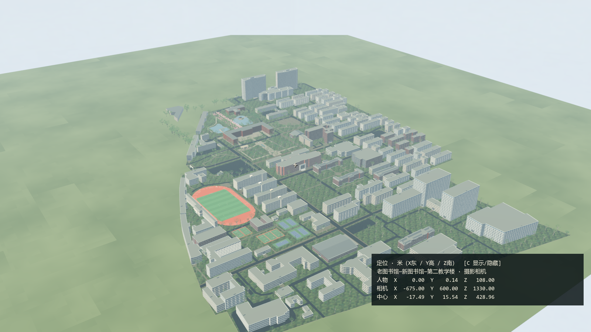
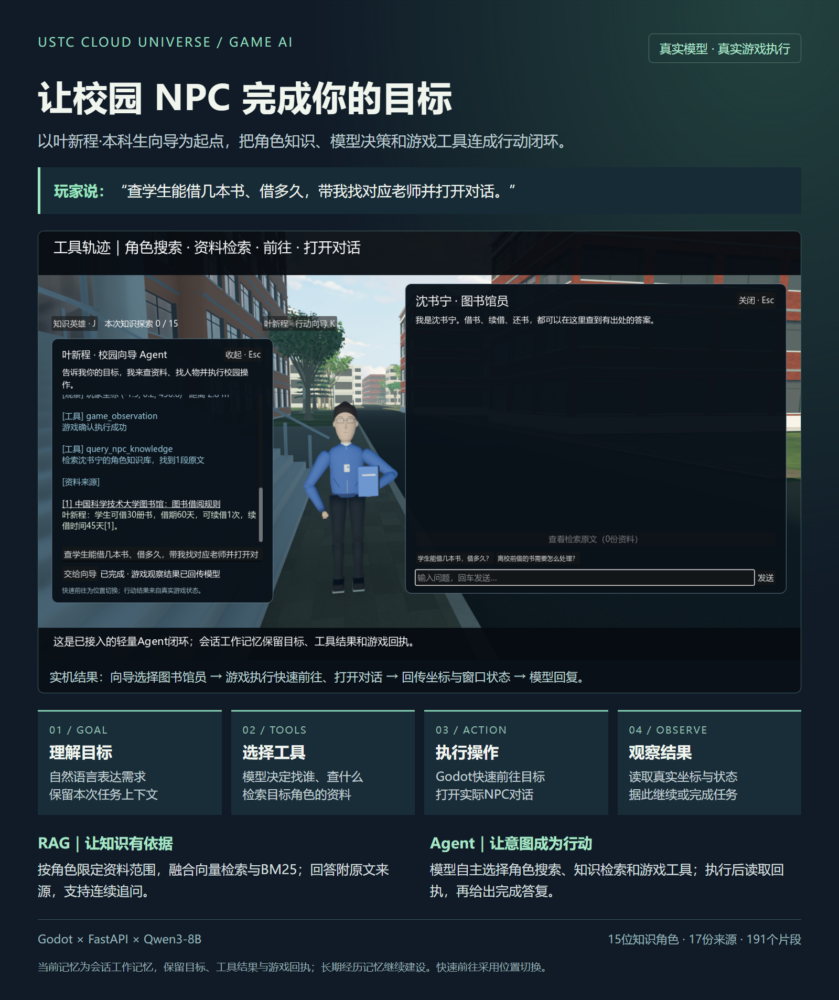
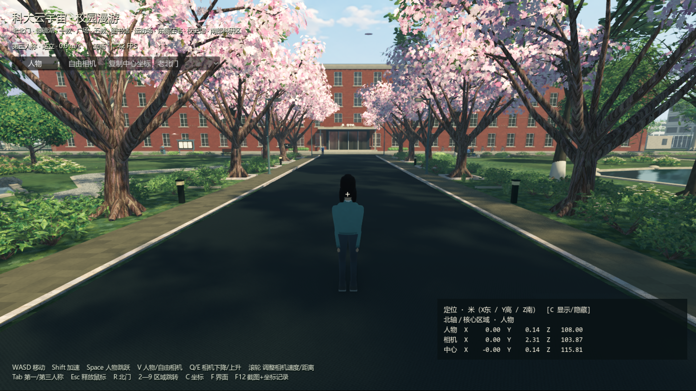

# 科大云宇宙

## 校园数字空间——链接现实与虚拟

**让真实校园在云端拥有一个持续生长的第二空间。**

科大云宇宙从中国科学技术大学东校区出发，探索一种新的校园入口：进入熟悉的校园，发现正在发生的事情，遇见志同道合的人，让线上的连接转化为现实中的活动、合作与创造。

我们的目标是建设一个与现实校园共同生长的数字世界。校园建筑将承载信息与服务，社团和实验室将拥有可访问的数字空间，师生与校友将通过数字身份保持连接。每一次活动、一次成果展示、一段校园记忆，都有机会成为这个世界的一部分。

[下载 Windows 试玩版](https://github.com/bingbingchang/ustc-cloud-universe/releases/tag/v0.1.0-alpha) · [项目介绍与参赛定位](docs/PROJECT_INTRO.md) · [未来发展路线](docs/VISION_ROADMAP.md) · [源码运行说明](docs/BUILD_GUIDE.md)

## 最新源码 AI NPC 与行动向导

当前源码新增 **15 位校园知识 NPC、RAG 问答、行动 Agent 与最小联机**。项目由常兵兵独立开发，使用 Godot、Blender、Python/FastAPI、Qwen3-8B 和 Qwen3-Embedding-0.6B。

角色按各自资料回答，向量检索与 BM25 通过 RRF 融合；玩家可查看回答依据。校园向导还能根据目标查角色、查资料、快速前往并打开对话，游戏执行后回传实际状态。

[20 秒实机视频](media/科大云宇宙_RAG与Agent_20秒实机.mp4) · [架构与面试演示](docs/AI_NPC_DEMO.md) · [AI 后台运行](campus/ai/README.md) · [源码运行](docs/BUILD_GUIDE.md) · [开发入口](campus/docs/team/README.md)

体验新增功能请运行当前源码；既有 `v0.1.0-alpha` Windows 下载包仍是此前的校园漫游版本。RAG 对话需要配置模型服务，校园与角色可独立运行。

## 今天可以体验什么

当前版本是可以实际运行的三维校园原型，支持人物漫游、第一与第三人称、自由相机、区域跳转，以及用于截图反馈的坐标定位。校园里已有建筑、道路、运动场、生活区、科研楼群、树木和校园人物与动物。

| 已完成成果 | 当前记录 |
|---|---|
| 东区外部区域地理覆盖 | 99.019%，按实际校界计算 |
| 最近一轮新增建筑 | 110栋外部建筑 |
| 最近一轮新增树木 | 410棵 |
| 人物实走验证 | 137条路线，累计约4.53公里 |
| 坐标与相机检查 | 15项通过，包含4K截图 |
| Windows独立试玩验证 | 人物、自由相机、区域跳转与截图保存等10项通过 |
| 原开发版本移动短测 | 本机1600×900、默认流畅档约70—138 FPS |

99.019%统计的是外部场景的地理范围，包含建筑和水体。建筑室内、未见立面和部分细节仍在打磨。当前源码已有 ENet 移动同步与文字聊天原型；账号、信息发布、报名及多人世界持久化属于后续建设。

## 一个云端校园可以承载什么

**信息有位置。** 讲座、社团招新、赛事、展览和校园通知，可以出现在对应场地。用户从空间里发现信息，查看详情、报名收藏，再走向现实中的活动现场。

**人与人有持续的连接。** 师生、校友和来访者可以拥有自己的数字身份，在云端校园交流、组队、展示作品、组织活动。社团和实验室可以经营自己的空间，让校园关系跨越时间与距离。

**知识和创造可以被看见。** 科研成果、学生项目、课程作品和创业想法，可以通过可访问的展厅、互动演示和虚拟活动呈现。未来，云端校园可以成为跨学科交流、项目协作和创新孵化的入口。

**现实与虚拟相互驱动。** 在现实地点扫码进入对应数字空间，在虚拟场景报名参加真实活动；用数字导览理解校园，用现实体验更新数字内容。进一步探索AI导览、空间问答、移动端定位和AR连接。

**校园文化可以持续积累。** 老照片、建筑变迁、人物故事、毕业纪念和校友记忆，可以逐步成为可探索的校园文化内容，让不同届、不同地域的人重新相遇。

**从科大走向更多校园。** 我们希望沉淀可复用的地图还原、场景生产和内容运营方法，让更多学校建设自己的数字空间，并探索跨校园的交流与合作网络。

以上是平台的发展愿景。当前试玩版提供校园空间与交互基础，我们将通过真实活动试点，逐步建立信息、身份、互动和服务能力。

## 开始试玩

在 [Releases](https://github.com/bingbingchang/ustc-cloud-universe/releases/tag/v0.1.0-alpha) 下载 Windows 压缩包，完整解压后运行 `USTCCloudUniverse.exe`。保留旁边的 `.pck` 文件，无需安装 Blender 或 Godot。

| 操作 | 功能 |
|---|---|
| WASD / Shift / Space | 人物移动、加速、跳跃 |
| 顶部按钮 / V | 人物与自由相机切换 |
| Q / E / 滚轮 | 自由相机下降、上升、调速 |
| Tab | 人物第一与第三人称切换 |
| Esc / 单击画面 | 释放鼠标、继续操控 |
| 顶部区域菜单 / 2—9 / R | 选择区域、快捷跳转、回北门 |
| C / F | 坐标显隐、主界面显隐 |
| F12 | 保存截图及同名坐标JSON |

截图反馈时，将问题对准中央准星，附上右下角的“中心”XYZ坐标。Windows试玩版截图保存到 `%APPDATA%\USTCCloudUniverse\screenshots`，可把这段路径粘贴到资源管理器地址栏打开。

## 建设方式

项目使用 Blender 与 Godot，将地图轮廓、校园GIS图片、官方总图与卫星影像交叉核对，再通过脚本生成建筑、道路、植被和设施。米制坐标贯穿数据、建模、人物移动与截图反馈，支持逐区还原和持续修正。

公开演示版采用原创校园人物与动物。地图来源及第三方说明见 [数据与素材来源](docs/DATA_SOURCES.md)。本项目为独立探索项目。

## 一起把云端校园做起来

我们欢迎开发者、设计师、校园社团、科研团队以及希望探索数字校园的合作伙伴参与。可以从一个活动、一间展厅、一条导览路线或一个互动服务开始，共同建设这个持续生长的校园数字空间。

通过 [Issues](https://github.com/bingbingchang/ustc-cloud-universe/issues) 提交场景反馈、功能建议与合作想法。
