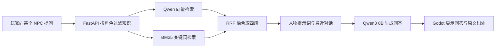

# 科大云宇宙 AI NPC 与 Agent 演示

开发者：常兵兵。项目将校园三维场景、角色知识问答与模型驱动的游戏操作接在一起，探索 AI 在校园游戏交互中的应用。


[观看或下载 20 秒实机](../media/科大云宇宙_RAG与Agent_20秒实机.mp4) · [后台安装运行](../campus/ai/README.md) · [当前代码地图](../campus/docs/team/ARCHITECTURE.md)

## 已实现的交互

- 15 位原创校园知识角色，分别有外形、职业动作、知识范围与对话历史。
- 资料问答采用角色过滤、向量与 BM25 混合检索、RRF 排名融合，并展示来源和召回原文。
- 向导 Agent 能查角色、查资料、请求快速前往和打开对话，读取 Godot 的实际执行结果后继续任务。
- 校园支持第一与第三人称漫游、自由相机、坐标截图，以及 ENet 主机、加入、玩家状态复制和文字聊天原型。

## RAG 如何运行



知识快照有 17 份来源、191 个片段。每个角色只检索自己对应的资料，15 人共用模型服务。当前使用 NumPy 直接做向量相似度，无需单独部署向量数据库；没有添加神经重排序模型。

`campus/ai/retrieval.py` 实现 BM25、向量相似度与 RRF；`app.py` 组织检索证据、提示词和引用；`godot/scripts/hero_interactions.gd` 负责人物面板、逐角色历史与游戏对话展示。

## Agent 如何影响游戏

玩家输入目标后，模型输出 JSON 工具决策。资料搜索在后台完成，位置切换与对话窗口由 Godot 执行。后台收到匹配的动作回执，再选择下一步或完成答复。

```text
目标 → 模型选工具 → 查角色或检索知识
                → 请求游戏动作 → Godot 执行
                                 → 回传观察 → 模型继续
```

实现位于 `campus/ai/campus_agent.py` 与 `campus/godot/scripts/campus_agent.gd`。当前动作包括快速位置切换和打开对话；工作记忆保留本次会话目标、工具结果与回执。

## 现场演示顺序

1. 运行当前源码并连接 RAG 服务，J 选择图书馆员，靠近按 E。
2. 提问“我是本科生，最多能借几本书，借多久”，展开原文核对。
3. 追问“没看完可以续借吗”，展示同一角色的连续对话。
4. 切换太阳物理研究员，用中文询问论文内容，查看英文原文。
5. K 打开向导，输入“查学生能借几本书、借多久，带我找对应老师并打开对话”，观察工具轨迹、位置变化和对话窗口。

## 代码与下载版本

`main` 已包含 AI 后台、NPC、Agent 和最小联机源码。现有 `v0.1.0-alpha` Windows 下载包对应此前的校园漫游版本；体验本页新增功能请运行当前源码并配置模型服务。

长期角色记忆、账号、背包与多人世界持久化在后续计划中。已有联机部分同步玩家移动与聊天；模型请求容量需要另行按目标人数测量。
